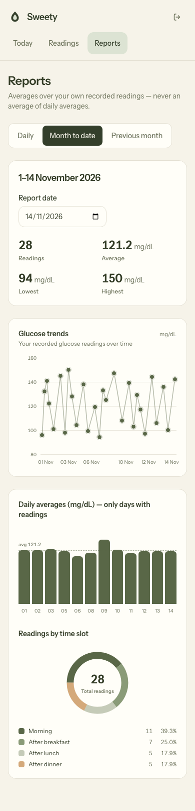

# SWEETy – Blood Glucose Tracker

SWEETy is a full-stack web application that lets a person with diabetes record up to four blood
glucose readings per day across four named time slots, and review daily, month-to-date, and
previous-month reports with summary statistics.

This repository covers **Phase 0 through Phase 7**: monorepo foundation, authentication,
readings CRUD, report generation, React frontend, testing and hardening, submission
preparation, and paginated readings history.

---

## Table of contents

- [Project overview](#project-overview)
- [Features](#features)
- [Screenshots](#screenshots)
- [Technology stack](#technology-stack)
- [Architecture](#architecture)
- [Repository structure](#repository-structure)
- [Prerequisites](#prerequisites)
- [Local installation](#local-installation)
- [Database setup](#database-setup)
- [Seed data](#seed-data)
- [Running the application](#running-the-application)
- [API documentation](#api-documentation)
- [Testing](#testing)
- [Security considerations](#security-considerations)
- [Assumptions and limitations](#assumptions-and-limitations)
- [Design system](#design-system)
- [Project phases](#project-phases)

---

## Project overview

SWEETy helps people managing diabetes track blood glucose levels without relying on a paper
logbook or a generic spreadsheet. A user logs in, records readings at up to four named points in
the day (morning fasting, after breakfast, after lunch, after dinner), and can review statistics
for any single day, the current month up to today, or the full previous calendar month.

The application is designed for personal, single-user use (one account per person). Doctor roles,
shared access, reminders, and notifications are intentionally out of scope for this release.

Main user workflows:

1. **Register or log in** using email and password.
2. **Record a reading** — pick the date, the slot, and enter the mg/dL value.
3. **Review the dashboard** — see today's readings at a glance, plus MTD and previous-month
   summaries.
4. **Browse history** — paginate through all past readings, optionally filtered by date.
5. **Open reports** — daily detail with a bar chart, or aggregate summaries for the month.
6. **Edit or delete** any of your own readings.
7. **Log out** — the session cookie is cleared server-side.

---

## Features

### Authentication

- User registration with name, email, and password
- Login and logout
- bcrypt password hashing (cost factor 12)
- JWT authentication (HS256) stored in an HTTP-only cookie — no tokens in localStorage
- Session resolved on page load via `GET /api/auth/me`
- Protected API endpoints and client-side route guards
- Authentication rate limiting (20 requests per 15 minutes by default)

### Glucose reading management

- Create, read, update, and delete blood glucose readings
- Four named daily slots: morning (fasting), after breakfast, after lunch, after dinner
- Maximum four readings per day per user (one per slot)
- Ownership enforcement on every query — a user's readings are never visible to another
- Date filtering and range filtering on the list endpoint
- Paginated list endpoint (`page` / `limit`) with user-scoped totals and deterministic ordering
- Glucose values validated to 40–600 mg/dL
- Dates stored as PostgreSQL `DATE` values in YYYY-MM-DD and exposed in DD-MM-YYYY format
- "Today" for the future-date rule computed in Asia/Kolkata timezone

### Reports

- **Daily report** — all readings for a chosen day in slot order, plus highest/lowest/average/count
- **Month-to-date report** — aggregates from the first of the current month through the chosen date
- **Previous-month report** — full calendar month before today, with correct January → December
  rollover and leap-year handling
- Aggregation computed in PostgreSQL (`MAX`, `MIN`, `AVG`, `COUNT`) — not fetched and filtered in
  JavaScript
- Average rounded to one decimal place; `null` (never `0`) when a period has no readings
- Chart data reuses the existing user-scoped readings endpoint with the report's own inclusive
  period — no separate chart API and no duplicate aggregation

### Frontend

- Landing page with product introduction
- Registration and login screens with client-side form feedback
- Authenticated dashboard: time-aware greeting, four daily slots, overview summary cards
- Readings history page with optional single-day filter, paginated controls, and a page-size
  selector (10 / 20 / 50)
- Reading add/edit/delete dialogs with field-level validation messages
- Reports page with daily, month-to-date, and previous-month tabs; summary statistics; a full-width
  individual-reading glucose trend chart; a daily-average bar chart; and a time-slot donut chart
- Charts are hand-drawn SVG/CSS components using the olive/sage palette — no charting dependency
- Responsive layout (mobile-first, works on 320 px–1440 px+ viewports)
- Cream and dark olive visual identity with accessible colour contrast
- Motion animations (page entrance, dialog open/close, tab crossfade) with `prefers-reduced-motion`
  support

### Testing

- 271 passing tests across 20 test files (see CI output for current results)
- Server integration tests using Supertest against a real PostgreSQL test database
- Client unit tests with Vitest and React Testing Library
- TypeScript strict mode — zero type errors
- ESLint clean — zero lint warnings or errors
- Prettier formatting enforced
- Both client and server production builds verified

---

## Screenshots

Phase 8 report captures are included below. The remaining legacy screenshots use the same manual
process described in [docs/screenshots/README.md](docs/screenshots/README.md).

| File                                          | Page                         |
| --------------------------------------------- | ---------------------------- |
| `docs/screenshots/01-landing.png`             | Landing page                 |
| `docs/screenshots/02-login.png`               | Login page                   |
| `docs/screenshots/03-register.png`            | Registration page            |
| `docs/screenshots/04-dashboard.png`           | Dashboard with demo readings |
| `docs/screenshots/05-readings.png`            | Readings history page        |
| `docs/screenshots/06-daily-report.png`        | Daily report with bar chart  |
| `docs/screenshots/07-monthly-reports.png`     | Monthly reports view         |
| `docs/screenshots/phase8-reports-desktop.png` | Phase 8 reports at 1280 px   |
| `docs/screenshots/phase8-reports-tablet.png`  | Phase 8 reports at 1024 px   |
| `docs/screenshots/phase8-reports-mobile.png`  | Phase 8 reports at 390 px    |
| `docs/screenshots/phase8-reports-daily.png`   | Phase 8 daily report view    |

### Phase 8 — Reports dashboard




---

## Technology stack

| Area         | Technology                                                       |
| ------------ | ---------------------------------------------------------------- |
| Frontend     | React 19, TypeScript 5.9, Vite 8, React Router 7, Tailwind CSS 4 |
| Animations   | Motion (`motion/react`, formerly Framer Motion)                  |
| Backend      | Node.js 22, Express 5, TypeScript 5.9, Zod 4                     |
| Auth         | bcryptjs, jsonwebtoken, HTTP-only cookies                        |
| Database     | PostgreSQL 17, Drizzle ORM 0.45, `pg`                            |
| Testing      | Vitest 4, React Testing Library, Supertest, jsdom                |
| Code quality | ESLint 10 (flat config), Prettier 3, strict TypeScript           |
| Dev tooling  | npm workspaces, `concurrently`, `tsx`                            |
| Containers   | Docker Compose with client, server, and PostgreSQL services      |

**Package manager:** npm. The project was scoped with Bun but the Docker requirement specified
Node.js and npm; npm workspaces are used consistently throughout.

---

## Architecture

SWEETy is an **npm-workspace monorepo** with two independently runnable applications:

- `apps/client` — Vite + React 19 single-page application. Communicates with the API over
  relative `/api/...` URLs (proxied by Vite in development, served through the same origin in
  production-like setups). No tokens are stored in browser storage; the HTTP-only cookie is the
  only credential.
- `apps/server` — Express 5 REST API. Organised as a modular structure: each domain (auth,
  readings, reports) has its own routes → controller → service → repository layers. Schema and
  migrations are managed with Drizzle ORM.

The two workspaces share a single root `.env` file (git-ignored) and are started together with
`npm run dev` via `concurrently`.

---

## Repository structure

```text
sweety/
├── apps/
│   ├── client/
│   │   ├── src/
│   │   │   ├── components/
│   │   │   │   ├── charts/          # Trend, bar, and donut chart components
│   │   │   │   ├── layout/          # AppLayout, AuthLayout
│   │   │   │   ├── readings/        # ReadingFormDialog, ReadingsList, DeleteReadingDialog
│   │   │   │   ├── reports/         # ReportSummaryStats
│   │   │   │   └── ui/              # Button, Card, Dialog, Input, StatusNote, icons
│   │   │   ├── context/             # AuthContext.tsx, auth.ts (useAuth hook)
│   │   │   ├── lib/                 # date.ts, slots.ts, chart.ts, useStatusNote.ts
│   │   │   ├── pages/               # LandingPage, LoginPage, RegisterPage,
│   │   │   │                        # DashboardPage, ReadingsPage, ReportsPage
│   │   │   ├── services/            # authApi.ts, readingsApi.ts, reportsApi.ts, http.ts
│   │   │   ├── types/               # user.ts, reading.ts, report.ts
│   │   │   ├── App.tsx
│   │   │   ├── index.css            # Tailwind v4 CSS-first config + design tokens
│   │   │   ├── main.tsx
│   │   │   └── setupTests.ts
│   │   ├── Dockerfile
│   │   ├── index.html
│   │   ├── package.json
│   │   ├── tsconfig.json
│   │   └── vite.config.ts
│   └── server/
│       ├── src/
│       │   ├── config/
│       │   │   └── env.ts           # Zod-validated environment schema
│       │   ├── database/
│       │   │   ├── index.ts         # pg Pool + Drizzle client
│       │   │   ├── schema.ts        # users, readings, enums
│       │   │   └── seed.ts          # Demo data seed script
│       │   ├── middleware/
│       │   │   ├── auth.ts          # requireAuth JWT middleware
│       │   │   └── rate-limit.ts    # Auth rate limiter factory
│       │   ├── modules/
│       │   │   ├── auth/            # routes, controller, service, repository,
│       │   │   │                    # validation, types, tokens — with tests
│       │   │   ├── health/          # health.routes.ts
│       │   │   ├── readings/        # routes, controller, service, repository,
│       │   │   │                    # validation, types, messages — with tests
│       │   │   └── reports/         # routes, controller, service, repository,
│       │   │                        # validation, types — with tests
│       │   ├── utils/
│       │   │   ├── database-errors.ts
│       │   │   ├── date.ts          # todayInAppTimezone, parseDDMMYYYY, toDDMMYYYY
│       │   │   ├── errors.ts        # HttpError
│       │   │   └── validation.ts
│       │   ├── app.ts
│       │   └── server.ts
│       ├── drizzle/                 # Generated SQL migrations
│       ├── tests/                   # Vitest global setup (test DB migration)
│       ├── Dockerfile
│       ├── drizzle.config.ts
│       ├── package.json
│       ├── tsconfig.json
│       ├── tsconfig.build.json
│       └── vitest.config.ts
├── docs/
│   ├── screenshots/                 # Screenshot capture instructions and images
│   │   └── README.md
│   ├── demo-script.md               # Step-by-step demo walkthrough script
│   └── README.md                    # Phase 0 notes
├── plans/                           # Animation implementation plans
├── .agents/                         # Agent task files and audit logs
├── .dockerignore
├── .env.example                     # Environment variable documentation template
├── .gitignore
├── .prettierignore
├── .prettierrc.json
├── docker-compose.yml
├── eslint.config.js
├── package-lock.json
├── package.json
├── README.md
└── tsconfig.base.json
```

---

## Prerequisites

- **Node.js** `^22.13.0` or `>=24.0.0`. Node.js 22 LTS is recommended and matches the Docker images.
- **npm** `>=10.0.0`.
- **Docker Desktop** (or Docker Engine with Compose v2) for the Docker workflow.
- **PostgreSQL 16+** only if running outside Docker; version 17 is used in Docker.

---

## Local installation

```bash
# 1. Clone the repository
git clone https://github.com/MainakSen30/sweety-blood-glucose-tracker.git
cd sweety-blood-glucose-tracker

# 2. Install all workspace dependencies
npm install

# 3. Create your local environment file
cp .env.example .env
```

Open `.env` and update at minimum:

- `DATABASE_URL` — your local PostgreSQL connection string
- `JWT_SECRET` — generate with `openssl rand -hex 32`
- `POSTGRES_PASSWORD` — if using Docker, set a non-placeholder password

---

## Database setup

Apply the database migrations before starting the server:

```bash
npm run db:migrate
```

This runs Drizzle migrations against the `DATABASE_URL` in `.env`. Both migrations must succeed:

- `0000_dry_stone_men.sql` — creates the `users` table
- `0001_glossy_layla_miller.sql` — creates the `readings` table and `reading_slot` enum

If PostgreSQL is not installed locally, start it via Docker first:

```bash
docker compose up -d postgres
```

then run migrations against `localhost` using the mapped port.

### Local PostgreSQL setup (without Docker)

```bash
# Create the development role and database
psql -d postgres -c "CREATE ROLE sweety WITH LOGIN PASSWORD 'change_me';"
createdb --owner=sweety sweety

# Create the dedicated test database for Vitest
psql -d postgres -c "CREATE ROLE sweety_test WITH LOGIN PASSWORD 'change_me';"
createdb --owner=sweety_test sweety_test
```

Replace `change_me` with the password you set in `.env`.

---

## Seed data

The seed script creates a demo account and approximately 30 days of synthetic glucose readings so
the application can be evaluated without entering real personal data.

### Enable the seed

The `npm run db:seed` command **does not** set `SEED_DEMO_DATA` automatically. You must supply it
explicitly on the command line each time you intend to seed.

**Running locally (host PostgreSQL):**

```bash
SEED_DEMO_DATA=true npm run db:seed
```

**Running via Docker Compose:**

```bash
docker compose exec server sh -c "SEED_DEMO_DATA=true /app/node_modules/.bin/tsx /app/apps/server/src/database/seed.ts"
```

> `tsx` is hoisted to the workspace root `node_modules`, so the full path is required inside the container.

### Demo credentials

| Field    | Value               |
| -------- | ------------------- |
| Email    | `demo@sweety.local` |
| Password | `Demo1234!`         |

### What the seed creates

- One user account with the demo credentials above.
- Readings for T-1 through T-30 (relative to today in Asia/Kolkata), covering:
  - Fully completed days (all 4 slots)
  - Partially completed days (1–3 slots)
  - Gap days (no readings)
- Readings spanning both the current month and the previous month, so the MTD and previous-month
  report pages display meaningful data.

**All generated values are synthetic demonstration data and have no medical significance.**

### Idempotency

The seed is safe to run multiple times:

- If the demo account already exists, it is not modified and the password is never overwritten.
- Reading inserts use `ON CONFLICT DO NOTHING`, so duplicate rows are silently skipped.

### Safety restrictions

The seed refuses to run unless all conditions are met:

1. `NODE_ENV` is not `production`.
2. `SEED_DEMO_DATA` is exactly `true` — supplied explicitly, never set by the npm script.
3. The database name in `DATABASE_URL` is on the explicit allowlist: `sweety`, `sweety_dev`, `sweety_demo`.
   Test databases (names ending in `_test` or `-test`) are always rejected.
4. No existing data is deleted or truncated.

---

## Running the application

### Host-local development

```bash
npm run dev
```

Starts both the Express API (port 5000) and the Vite dev server (port 5173) concurrently.
The Vite server proxies `/api` requests to the Express API.

- Frontend: `http://localhost:5173`
- API health: `http://localhost:5000/api/health`

Start individually when needed:

```bash
npm run dev:server   # Express API with tsx watch
npm run dev:client   # Vite dev server
```

### Docker Compose

```bash
docker compose up --build
```

Starts three services: `postgres` (PostgreSQL 17), `server` (Express API), and `client` (Vite).
Services start in dependency order with health checks.

- Frontend: `http://localhost:5173`
- API health: `http://localhost:5000/api/health`
- PostgreSQL from host tools: `localhost:5432` (or `POSTGRES_PORT` if overridden)

```bash
docker compose up -d --build    # run in background
docker compose logs -f          # follow logs
docker compose down             # stop (data volume preserved)
docker compose down -v          # stop and delete database volume (destructive)
```

### Port conflicts

macOS AirPlay Receiver commonly uses port 5000. If the API cannot bind:

```dotenv
PORT=5001
VITE_API_PROXY_TARGET=http://localhost:5001
```

For Docker, set only `SERVER_PORT=5001` — the internal port 5000 is unaffected.

---

## Scripts

### Root scripts

| Command                      | Description                                      |
| ---------------------------- | ------------------------------------------------ |
| `npm run dev`                | Start API and client concurrently                |
| `npm run dev:client`         | Start only the Vite dev server                   |
| `npm run dev:server`         | Start only the Express API in watch mode         |
| `npm run build`              | Build both workspaces                            |
| `npm test`                   | Run all test suites once                         |
| `npm run test:watch`         | Run test suites in watch mode                    |
| `npm run typecheck`          | TypeScript check in both workspaces              |
| `npm run lint`               | ESLint over the repository                       |
| `npm run lint:fix`           | ESLint with auto-fix                             |
| `npm run format`             | Prettier write                                   |
| `npm run format:check`       | Prettier check without writing                   |
| `npm run db:generate`        | Generate a Drizzle migration from schema changes |
| `npm run db:migrate`         | Apply pending Drizzle migrations                 |
| `npm run db:push`            | Push schema to DB directly (development only)    |
| `npm run db:studio`          | Open Drizzle Studio                              |
| `npm run db:seed`            | Seed demo account and synthetic readings         |
| `npm run docker:up`          | Build and start the full Compose stack           |
| `npm run docker:up:detached` | Build and start in background                    |
| `npm run docker:down`        | Stop containers (data volume preserved)          |
| `npm run docker:logs`        | Follow Compose service logs                      |
| `npm run docker:ps`          | Show Compose service status                      |

---

## API documentation

All API responses use `Content-Type: application/json`. Error responses have the shape:

```json
{ "status": "error", "message": "Human-readable message." }
```

Validation errors add a `details` array:

```json
{
  "status": "error",
  "message": "Validation failed.",
  "details": [{ "path": "fieldName", "message": "Specific message." }]
}
```

### Health

```http
GET /api/health
```

Response `200`:

```json
{ "status": "ok", "message": "Sweety API is running" }
```

### Authentication

| Method | Endpoint             | Auth required | Description                           |
| ------ | -------------------- | ------------- | ------------------------------------- |
| `POST` | `/api/auth/register` | No            | Create account and start session      |
| `POST` | `/api/auth/login`    | No            | Authenticate and start session        |
| `GET`  | `/api/auth/me`       | Yes           | Return the authenticated user profile |
| `POST` | `/api/auth/logout`   | No            | Clear the session cookie              |

#### POST /api/auth/register

```json
{ "name": "Demo User", "email": "demo@example.com", "password": "SecurePassword123" }
```

`201 Created` — returns a safe user (never includes the password hash) and sets the
`sweety_access_token` HTTP-only cookie:

```json
{
  "id": "6f1c2b52-9f2f-4f1e-9f9a-1a2b3c4d5e6f",
  "name": "Demo User",
  "email": "demo@example.com",
  "createdAt": "2026-11-12T00:00:00.000Z",
  "updatedAt": "2026-11-12T00:00:00.000Z"
}
```

Errors: `400` for validation failures (name required, valid email, password ≥ 8 characters);
`409` when the email is already registered.

#### POST /api/auth/login

```json
{ "email": "demo@example.com", "password": "SecurePassword123" }
```

`200 OK` — same user shape as register, sets the auth cookie.

Errors: `401 "Invalid email or password."` for wrong password or unknown email (generic message
to prevent user enumeration). `429` when rate-limited.

#### GET /api/auth/me

Requires the `sweety_access_token` cookie. Returns the authenticated user; `401` if the cookie
is missing, invalid, or expired.

#### POST /api/auth/logout

`200 OK`. Clears the auth cookie with matching options. Safe to call when already logged out.

### Blood glucose readings

All reading endpoints require authentication (`401` otherwise). Readings always belong to the
authenticated user; a user ID in the request body is never trusted.

| Method   | Endpoint            | Description                                 |
| -------- | ------------------- | ------------------------------------------- |
| `POST`   | `/api/readings`     | Create a reading                            |
| `GET`    | `/api/readings`     | List readings (paginated, optional filters) |
| `GET`    | `/api/readings/:id` | Retrieve one reading                        |
| `PATCH`  | `/api/readings/:id` | Update one reading                          |
| `DELETE` | `/api/readings/:id` | Delete one reading                          |

#### POST /api/readings

```json
{ "readingDate": "12-11-2026", "slot": "morning", "value": 105 }
```

`201 Created`:

```json
{
  "id": "0f8d4c7a-4f3e-4d8a-9d3e-6e2a1b7c9d01",
  "userId": "6f1c2b52-9f2f-4f1e-9f9a-1a2b3c4d5e6f",
  "readingDate": "12-11-2026",
  "slot": "morning",
  "value": 105,
  "createdAt": "2026-11-12T10:30:00.000Z",
  "updatedAt": "2026-11-12T10:30:00.000Z"
}
```

`readingDate` format: `DD-MM-YYYY`. Valid slots: `morning`, `after_breakfast`, `after_lunch`,
`after_dinner`. Value range: 40–600 (integer). Dates may not be in the future (Asia/Kolkata).

Errors: `400` for validation; `409` for duplicate slot on the same date, or a fifth reading on
the same day.

#### GET /api/readings

```http
GET /api/readings                                          # page 1, 20 per page
GET /api/readings?page=2&limit=20                          # second page
GET /api/readings?page=1&limit=10                          # custom page size
GET /api/readings?date=12-11-2026                          # single day
GET /api/readings?from=01-11-2026&to=10-11-2026            # date range
GET /api/readings?from=01-11-2026&to=10-11-2026&page=2     # filters + pagination
```

Query parameters:

| Parameter | Default | Validation                                                    |
| --------- | ------- | ------------------------------------------------------------- |
| `page`    | `1`     | Positive integer.                                             |
| `limit`   | `20`    | Positive integer, maximum `100`.                              |
| `date`    | —       | Single `DD-MM-YYYY` day. Cannot be combined with `from`/`to`. |
| `from`    | —       | Inclusive `DD-MM-YYYY` range start.                           |
| `to`      | —       | Inclusive `DD-MM-YYYY` range end.                             |

Results are sorted by `readingDate` descending, then slot order
(`morning`, `after_breakfast`, `after_lunch`, `after_dinner`), with the reading id as a final
deterministic tie-breaker. Pagination is applied after filtering; `total` always counts the full
filtered result set for the authenticated user.

Response `200`:

```json
{
  "data": [
    {
      "id": "0f8d4c7a-4f3e-4d8a-9d3e-6e2a1b7c9d01",
      "userId": "6f1c2b52-9f2f-4f1e-9f9a-1a2b3c4d5e6f",
      "readingDate": "12-11-2026",
      "slot": "morning",
      "value": 105,
      "createdAt": "2026-11-12T10:30:00.000Z",
      "updatedAt": "2026-11-12T10:30:00.000Z"
    }
  ],
  "pagination": {
    "page": 1,
    "limit": 20,
    "total": 45,
    "totalPages": 3,
    "hasNextPage": true,
    "hasPreviousPage": false
  }
}
```

Pagination metadata:

- `total` — matching readings owned by the authenticated user.
- `totalPages` — `ceil(total / limit)`; `0` when the user has no matching readings.
- `hasNextPage` / `hasPreviousPage` — whether adjacent pages exist.

Edge cases:

- A user with no readings receives `data: []`, `total: 0`, `totalPages: 0`, and both navigation
  flags `false`.
- The last page may contain fewer than `limit` readings.
- A page beyond the last page returns `data: []` and valid metadata for the requested page; it
  never silently returns a different page.
- Invalid `page` or `limit` values return the standard `400` validation response with a `details`
  entry whose `path` is `page` or `limit`.

#### PATCH /api/readings/:id

At least one field required. Supports `value`, `slot`, and `readingDate`. Nonexistent or
foreign-owned readings return `404`.

#### DELETE /api/readings/:id

`200 OK` — `{ "status": "ok", "message": "Reading deleted successfully." }`. Nonexistent or
foreign-owned readings return `404`.

### Reports

All report endpoints require authentication. All dates in requests and responses use `DD-MM-YYYY`.

Report summary shape:

```json
{
  "highest": 145,
  "lowest": 95,
  "average": 122.0,
  "totalReadings": 4
}
```

`highest`, `lowest`, and `average` are `null` (never `0`) when the period has no readings.

#### GET /api/reports/daily

```http
GET /api/reports/daily?date=12-11-2026
```

Returns slot-ordered readings plus a summary:

```json
{
  "reportType": "daily",
  "date": "12-11-2026",
  "summary": { "highest": 145, "lowest": 95, "average": 122.0, "totalReadings": 4 },
  "readings": [
    { "id": "...", "readingDate": "12-11-2026", "slot": "morning", "value": 95 },
    { "id": "...", "readingDate": "12-11-2026", "slot": "after_breakfast", "value": 145 }
  ]
}
```

Empty days return `200` with `null` aggregates and `readings: []`.

#### GET /api/reports/month-to-date

```http
GET /api/reports/month-to-date?date=12-11-2026
```

Aggregates from the first of the selected month through the selected date:

```json
{
  "reportType": "month-to-date",
  "period": { "startDate": "01-11-2026", "endDate": "12-11-2026" },
  "summary": { "highest": 180, "lowest": 85, "average": 121.5, "totalReadings": 24 }
}
```

#### GET /api/reports/monthly

No query parameter. Period is the full previous calendar month (determined in Asia/Kolkata):

```json
{
  "reportType": "monthly",
  "period": { "startDate": "01-10-2026", "endDate": "31-10-2026" },
  "summary": { "highest": 190, "lowest": 78, "average": 119.4, "totalReadings": 96 }
}
```

#### Chart data

The Reports page draws individual readings from the existing endpoints rather than a dedicated
chart API. The daily report already returns its readings; period reports expose the exact
`period.startDate` / `period.endDate`, which the client passes to `GET /api/readings` as `from` /
`to`. That endpoint is user-scoped, applies inclusive date boundaries, and returns every reading
with its slot, so the trend and donut charts cannot include another user's data or fabricate
observations. Slots are counted client-side from the same readings the trend line plots.

---

## Testing

### Run the test suite

```bash
npm test
```

Runs all test suites in both workspaces (Vitest, React Testing Library, Supertest).

### Individual quality checks

```bash
npm run typecheck       # TypeScript strict check in both workspaces
npm run lint            # ESLint
npm run format:check    # Prettier formatting check
npm run build           # Production build for both workspaces
```

### Test database requirement

Server tests require `TEST_DATABASE_URL` to be set in `.env`. The database name **must** end with
`_test`; the test runner throws if it does not, preventing destructive cleanup from targeting any
other database.

Vitest's global setup applies committed Drizzle migrations to the test database before any test
runs, so the test schema always matches the repository.

### What is tested

- Express health endpoint
- Full authentication flow (register, login, `/me`, logout) with real HTTP + PostgreSQL
- Password hash verification in the database
- Case-insensitive duplicate email detection
- JWT middleware (missing, invalid, expired, wrong algorithm tokens)
- Complete readings CRUD: creation validation (range, slots, dates, duplicates, daily limit),
  multi-user ownership isolation, list filtering, sorting, pagination (defaults, custom limits,
  final/empty/beyond-last pages, per-user totals), update conflicts, deletion, cascade constraints
- Reports: daily, month-to-date, previous-month — authentication, validation, known-value
  aggregation, rounding, two-user isolation
- Report chart data: individual readings without aggregation, all four slots, inclusive period
  boundaries, deterministic ordering, user scoping, and empty periods
- Client report charts: trend points from real API data, same-day observations preserved, no trend
  line for a single reading, donut counts/percentages, tab and date changes, empty/loading/error
  states, and the existing daily-average bar chart
- Client routing and redirects
- Client date conversion utilities
- Client readings pagination (controls, page changes, loading/error states, page-size reset,
  mutation refresh, empty-page fallback)
- Reading form dialog behaviour
- HTTP error handling

Test counts: see CI output for current results.

---

## Security considerations

### What is in place

- **bcrypt password hashing** — cost factor 12; plaintext passwords never stored or returned
- **HTTP-only cookies** — the JWT is not accessible to browser JavaScript
- **`SameSite=Lax`** — mitigates most cross-site POST attacks
- **`Secure` flag** — set in production (cookie only sent over HTTPS)
- **JWT with minimal claims** — only `sub` (user UUID) plus standard expiry; subject validated to
  be a UUID
- **Ownership enforcement** — every read/update/delete filters by both record ID and user ID; a
  foreign record returns `404`, not `403`, to avoid confirming existence
- **Rate limiting** — registration and login endpoints limited to 20 requests per 15 minutes per IP
- **Helmet** — sets standard security HTTP response headers
- **CORS** — restricted to `CLIENT_URL`; `credentials: true`
- **Zod validation** — all inputs validated at the API boundary before touching the database
- **Parameterised queries** — Drizzle ORM uses parameterised SQL; no raw string concatenation

### Known limitations

- **No CSRF token** — `SameSite=Lax` and JSON-only bodies reduce exposure, but a dedicated CSRF
  token or `SameSite=Strict` should be added before production
- **No token revocation** — a stolen cookie remains valid until `JWT_EXPIRES_IN` elapses; a
  revocation list or refresh-token rotation would address this
- **In-memory rate limiting** — counters reset on restart and are not shared across instances; not
  suitable for multi-instance deployments without a shared store (e.g. Redis)
- **Register reveals email existence** — `409` on duplicate registration is an inherent UX
  trade-off
- **Dockerfiles target development** — `tsx watch` and Vite HMR are not suitable for production;
  a production deployment would require a proper web server and static file serving setup

---

## Assumptions and limitations

- npm is used throughout; Bun is not installed or required.
- The application timezone is **Asia/Kolkata**. "Today" for future-date validation and report
  period calculation is determined in this timezone. `APP_TIMEZONE` in
  `apps/server/src/utils/date.ts` is the single place to change it.
- The daily-limit check is count-then-insert; two simultaneous creates for the same day could
  theoretically land a fifth reading (the unique slot index still prevents duplicates).
- Authentication cookies are only `Secure` in production. Local development over plain HTTP is
  intentional and expected.
- Report charts fetch the selected period through the paginated readings endpoint (100 per page).
  At the four-readings-per-day limit a month is at most 124 readings, so this is at most two
  requests; a dedicated chart endpoint was not needed.
- The trend line joins consecutive recorded observations. Days without readings contribute no
  point, but the line spans the gap between surrounding observations; it does not invent daily
  values.
- Chart tooltips appear on hover and keyboard focus. The donut legend states each slot's count and
  percentage in text, so colour is not the only carrier of information.
- The `GET /api/health` endpoint returns `200` after a successful database connection check at
  startup; it does not query the database on every request.
- Doctor roles, reminders, notifications, and exports are intentionally out of scope.

---

## Design system

The client uses a warm, calm health-tech identity: **cream background, dark olive typography**.

| Token        | Value     | Use                                       |
| ------------ | --------- | ----------------------------------------- |
| `cream`      | `#F6F3E9` | Page background                           |
| `surface`    | `#FFFEF8` | Cards, inputs                             |
| `ink`        | `#343D27` | Primary text, values                      |
| `ink-soft`   | `#6A7058` | Secondary text (≥4.5:1 contrast on cream) |
| `olive`      | `#596747` | Interactive accents, chart bars           |
| `olive-dark` | `#343F2B` | Primary buttons, active nav, brand        |
| `sage`       | `#DCE3D3` | Filled/selected states                    |
| `beige`      | `#EAE4D4` | Empty-slot surfaces                       |
| `line`       | `#E4E0D3` | 1 px borders                              |
| `terracotta` | `#C98568` | Destructive actions and small accents     |

Tokens live in `@theme` in `apps/client/src/index.css` (Tailwind v4 CSS-first configuration).

Typography: **Instrument Sans** (Google Fonts, 400–700). Numeric values use `tabular-nums`.

Motion: `motion/react` for page entrance, dialog open/close (200 ms ease-out, scale 0.97), and
report-tab crossfade. `prefers-reduced-motion` is honoured globally (CSS) and in component logic
(`useReducedMotion`).

---

## Project phases

### Phase 0 — Foundation

npm workspaces, shared TypeScript configuration, React + Vite + Tailwind client skeleton, Express
backend with Helmet/CORS/JSON parsing, Zod environment validation, PostgreSQL connection, Drizzle
client, `/api/health` endpoint, graceful shutdown, Docker Compose with health checks, ESLint,
Prettier, and initial test scaffolding.

### Phase 1 — Authentication and user foundation

`users` table with case-insensitive email uniqueness, Zod-validated register/login/me/logout
endpoints, bcrypt hashing (cost 12), HS256 JWT in an HTTP-only cookie, `requireAuth` middleware,
in-memory rate limiting, typed frontend auth API client, integration tests.

### Phase 2 — Blood glucose readings

`readings` table (date-only, slot enum, value check constraint, unique per user/date/slot, cascade
delete), authenticated CRUD endpoints with ownership on every query, Zod validation with friendly
messages, date-only storage in `YYYY-MM-DD` with `DD-MM-YYYY` API surface, typed frontend
readings API client, comprehensive integration tests.

### Phase 3 — Report generation and analytics

Daily, month-to-date, and previous-month report endpoints; PostgreSQL aggregation; correct
boundary math for January → December rollover and leap-year February; injectable date-range
helpers with unit tests; typed frontend reports API client.

### Phase 4 — Frontend implementation and visual design

React 19 single-page application: landing page, auth screens, authenticated dashboard, readings
history, reports page with bar charts; cream/olive design system; Motion animations;
`prefers-reduced-motion` support; responsive layout; client unit tests.

### Phase 5 — Testing and hardening

148 passing tests across 9 test files; TypeScript strict mode clean; ESLint clean; Prettier
enforced; both production builds verified; malformed JSON handling fixed; test isolation
hardened with `fileParallelism: false` and `_test`-suffixed database enforcement.

### Phase 6 — Submission preparation

Database seed script with safety guards and idempotent demo data; `.env.example` audit and
documentation of all variables including `SEED_DEMO_DATA`; full README update covering Phases
0–6; screenshot capture instructions and demo walkthrough script.

### Phase 7 — Readings pagination

User-scoped `page` / `limit` pagination on `GET /api/readings` with Zod-validated query params,
shared filter conditions for the data and count queries, deterministic ordering, structured
`data` + `pagination` responses, and Previous/Next pagination controls with a page-size selector
on the Readings page. Documented defaults, maximum limit, and beyond-last-page behaviour.

### Phase 8 — Advanced reports and data visualization

Full-width glucose trend line chart of individual readings (chronological, slot-ordered, with
hover/keyboard tooltips) and a time-slot donut chart with counts and percentages, both driven by
the selected Daily / Month-to-date / Previous-month period. The existing daily-average bar chart
is preserved. Both new charts are hand-drawn SVG/CSS components — no charting dependency was
added — with responsive stacking, labelled loading/empty/error states, and text equivalents for
assistive technologies.

---

## Environment variable reference

| Variable                    | Required    | Purpose                                                       | Default                 |
| --------------------------- | ----------- | ------------------------------------------------------------- | ----------------------- |
| `NODE_ENV`                  | No          | Runtime mode (`development`/`test`/`production`)              | `development`           |
| `PORT`                      | No          | Express server port (host-local)                              | `5000`                  |
| `CLIENT_URL`                | No          | CORS allowed origin                                           | `http://localhost:5173` |
| `DATABASE_URL`              | **Yes**     | PostgreSQL connection string                                  | —                       |
| `TEST_DATABASE_URL`         | For tests   | Vitest test database (must end with `_test`)                  | —                       |
| `JWT_SECRET`                | **Yes**     | JWT signing key (≥32 chars). Generate: `openssl rand -hex 32` | —                       |
| `JWT_EXPIRES_IN`            | No          | JWT + cookie lifetime (e.g. `1h`, `7d`)                       | `1h`                    |
| `AUTH_RATE_LIMIT_WINDOW_MS` | No          | Auth rate-limit window (ms)                                   | `900000`                |
| `AUTH_RATE_LIMIT_MAX`       | No          | Max auth requests per window per IP                           | `20`                    |
| `POSTGRES_DB`               | For Docker  | PostgreSQL database name (Compose)                            | `sweety`                |
| `POSTGRES_USER`             | For Docker  | PostgreSQL user (Compose)                                     | `sweety`                |
| `POSTGRES_PASSWORD`         | For Docker  | PostgreSQL password (Compose)                                 | —                       |
| `POSTGRES_PORT`             | For Docker  | Host port mapped to container 5432                            | `5432`                  |
| `SERVER_PORT`               | For Docker  | Host port mapped to container 5000                            | `5000`                  |
| `CLIENT_PORT`               | For Docker  | Host port mapped to container 5173                            | `5173`                  |
| `VITE_API_PROXY_TARGET`     | No          | Vite proxy target for `/api` requests                         | `http://localhost:5000` |
| `SEED_DEMO_DATA`            | For seeding | Must be `true` to allow seed script to run                    | unset                   |
